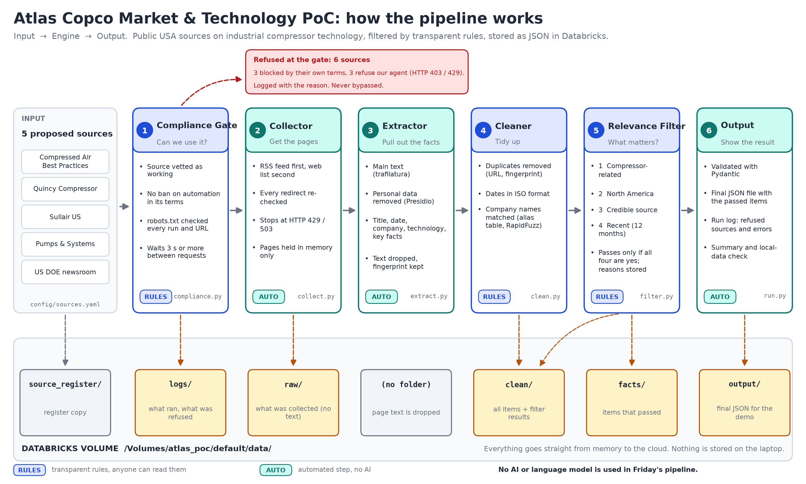

# prepare.md: everything you need to present this project

Read this top to bottom once, then use sections 1, 2, 12 and 13 as your cheat sheet on the day. Every fact here was checked against the code or a real run on 29 Oct 2026. Where something is a limitation, it says so; say it the same way if asked.

## Contents

1. The project in 60 seconds
2. The pipeline (image)
3. The pipeline step by step, with the code file for each step
4. The filters (all of them)
5. What "model" do we use? (short answer: no AI)
6. Libraries
7. Where everything is in the code
8. What the output looks like
9. Sources: what we use, what we found blocked
10. Compliance: how we stay legal
11. Results so far (real numbers)
12. How to run and demo it
13. Questions you may get, with answers
14. Honest limitations
15. What comes next
16. Numbers cheat sheet

---

## 1. The project in 60 seconds

**The client.** Atlas Copco is a Swedish industrial group. Its biggest business area is Compressor Technique (about 46% of 2025 revenue). It grows by acquiring companies (29 announced in 2025), from small local service firms to technology companies.

**The problem.** Atlas Copco wants to see who is building what in the compressor market, so their team can spot relevant companies and technology sooner. After our first meeting (16 Oct) they told us our first design was over-engineered. They want a simple proof of concept (PoC), results before cleverness, and no data stored on laptops.

**What we built.** A "scout": a program that visits a short list of approved, public USA websites, collects their newest items, removes personal data, keeps only the items that pass four transparent yes/no checks, and writes the result as JSON into a Databricks cloud folder. One command runs everything: `python -m atlas.run`.

**The one-sentence version for the room:**
> "With one command, a program reads five trusted USA industry sources, checks it is allowed to, throws away the page text and keeps only a source link and a few facts, filters for compressor relevance with rules anyone can read, and stores the result in a cloud folder with the reason for every decision. Running it weekly is the next step."

**Three things Atlas Copco cares about, and our answer:**

| They care about | Our answer |
|---|---|
| Not over-engineered | Input, Engine, Output. Plain Python and rules. No AI model, no graph database, no embeddings |
| Data not stored locally | Everything goes from memory straight to Databricks. The program checks this itself at the end of every run |
| Results, not cleverness | A working run today: 5 sources, JSON in Databricks, every item has a link, a date, a reason it passed or failed |

---

## 2. The pipeline (image)



*The image is `docs/images/pipeline.png` (also `pipeline.svg`, which stays sharp at any size). Put the PNG on a slide. Regenerate it with `python docs/images/make_pipeline_diagram.py` (needs `pip install matplotlib`).*

**How to read it.** Data flows left to right through six boxes. The five source names on the left are the input. The six blue and green boxes are the engine; each box shows the code file that does the job. The yellow folders at the bottom are the Databricks Volume, which is the output. Blue "RULES" boxes are transparent rules; green "AUTO" boxes are automated steps. **None of them is AI.**

---

## 3. The pipeline step by step

`atlas/run.py` runs these steps for each source, in this order.

### Step 1. Compliance Gate: "Can we use it?" (`atlas/compliance.py`)

Decides whether a source may be visited at all, before any page is fetched.

A source is allowed only if all of these are true:
- its approval status is `proposed` or `approved` (not `blocked` or `needs_permission`),
- its vetting result is `working`,
- its terms of use do not forbid automated access,
- its `robots.txt` allows our listing page.

Otherwise it is refused, and every reason is logged (for example `status_blocked, vetting_blocked, terms_forbid_automation`). A refused source is not contacted at all.

It also controls *how* we fetch:
- **robots.txt is checked at the start of every run and again before every URL.**
- **Delay:** at least 3 seconds between requests to the same site, or the site's own `Crawl-delay` if larger.
- **We introduce ourselves:** every request carries the User-Agent `AtlasCopcoStudentPoC/0.1 (+contact: industrymlcp@gmail.com)`. We never disguise it.
- robots.txt answers are read the standard way: 200 = follow the rules; 404 = no restrictions; 401/403 = treat as "everything disallowed"; a server error = treat as disallowed.

### Step 2. Collector: "Get the pages" (`atlas/collect.py`)

- **RSS feed first** (read with `feedparser`), **web list page second** (links picked out with `lxml` using a pattern from the source register).
- Every article page is checked with the gate, then fetched politely.
- **Redirects are followed by hand**, and each hop is re-checked. A redirect to a different site is refused.
- Only HTTP 200 HTML pages are accepted; pages over 3 MB are refused.
- **HTTP 429 or 503 means stop** for that source. No retries, no tricks.
- Pages stay **in memory only**. The raw HTML is never written anywhere.
- What is saved to `raw/` is metadata only: URL, title from the feed, date from the feed, time collected.

### Step 3. Extractor: "Pull out the facts" (`atlas/extract.py`)

Turns one page into one record. This is the biggest step, and it happens entirely in memory.

1. **Main text** is pulled out with `trafilatura` (it removes menus, ads and footers).
2. **Date:** read from the page's own metadata or its dateline; falls back to the feed's date. A date that is exactly 1 January and came only from a loose search is thrown away (it was a "© 2026" footer misread). If there is no real date, the date stays empty. **We never use today's date or guess.**
3. **Personal data is removed** with Presidio plus a small spaCy language model: names, emails, phone numbers, card numbers, IP addresses and similar become `<PERSON>`, `<EMAIL>` and so on. Company names and US place names are protected by an allow-list so they are not wiped. A surname that appears alone after a full name is removed too.
4. **Signals** are computed while the text is still in memory: which compressor keywords appear, whether a US place is mentioned, whether the text looks industrial.
5. **Technology** is labelled from a list (for example "oil-free rotary screw compressor"); empty if nothing matches.
6. **Company:** for a competitor's own newsroom it is that company. For other sources: a known company from `config/aliases.yaml` first; otherwise a model guess is accepted only if the same name appears twice; otherwise left empty. **A wrong guess is worse than empty.**
7. **Key facts:** up to 3 short sentences (max 200 characters), picked by rule: sentences with a compressor keyword, a number with a unit, or an event verb (announce, launch, acquire...). Headline repeats, navigation labels and boilerplate are skipped.
8. **Label:** `fact` or `claim` (see section 4).
9. **The text is dropped.** Only a fingerprint (SHA-256 of the cleaned text) is kept, so a later run can tell if a page changed.

### Step 4. Cleaner: "Tidy up" (`atlas/clean.py`)

- Removes duplicates: first by URL (ignoring tracking parameters and trailing slashes), then by fingerprint (same content, different URL).
- Makes sure dates are ISO format (`YYYY-MM-DD`).
- Matches company-name variants to one name ("Ingersoll-Rand", "Ingersoll Rand Inc." and "IR" all become "Ingersoll Rand"), using an alias table and a fuzzy match (score of 92 or more out of 100) with `RapidFuzz`. No match means the name is left as written.

### Step 5. Relevance Filter: "What matters?" (`atlas/filter.py`)

Four yes/no checks on every item (details in section 4). An item passes only if all four are yes. **Items that fail are not deleted**; they stay in `clean/` with their reasons, so you can show what the filter removed and why.

### Step 6. Output (`atlas/run.py`)

- Every record is checked against a strict data model (Pydantic) before it is written.
- The final file `output/poc_<run_id>.json` holds only the items that passed, plus a summary per source.
- A run log records which sources were refused and why, and any errors. It never contains page content.
- At the end the program prints a summary table and **checks that no data file appeared on the laptop**.
- One failing source or page never stops the others; failures are reported, not hidden.

---

## 4. The filters (all of them)

There are filters at three levels. Be clear which one you mean.

### 4a. The relevance filter: four checks per item (`atlas/filter.py`, function `_judge`)

| # | Check | Rule | Reason code if it fails |
|---|---|---|---|
| 1 | `compressor_related` | The item matched at least one compressor keyword in its text, **or** the title contains one | `no_compressor_keyword` |
| 2 | `north_america` | The source's region is US/CA/MX, **or** the text mentions a US place | `not_north_america` |
| 3 | `credible_source` | The source is in our register, vetted `working`, and its status is `proposed` or `approved`. Unknown sites fail | `source_not_credible` |
| 4 | `recent` | Published in the last **12 months** (configurable) | `too_old`, `date_missing`, or `date_in_future` |

`passed = all four true`. The result is stored on the item, e.g. `"filter": {"compressor_related": true, "north_america": true, "credible_source": true, "recent": true, "passed": true, "reasons": []}`.

- **Keywords** live in `config/keywords.yaml` so the team can edit them without touching code: 18 compressor terms (compressor, compressed air, rotary screw, centrifugal compressor, oil-free, air end, CFM, VSD...), 6 industrial terms, 28 US place names. Matching is whole-word and case-insensitive.
- **"Industrial" is a flag, not a gate** (a decision we made): an item about compressors passes even without that word. The flag `industrial_hint` is recorded so it can be made a requirement later.
- **No date means fail.** If we cannot find a real publication date we do not guess; the item fails with `date_missing`.

### 4b. The source filter: the Compliance Gate (section 3, step 1)

This is a filter on *websites*, not items: status, terms of use, robots.txt. It is why 6 of our 11 vetted sources are refused.

### 4c. Quality rules inside the engine

| Rule | Where | Why |
|---|---|---|
| Duplicate removal (URL, then fingerprint) | `clean.py` | The same story can appear twice |
| Personal data removal | `extract.py` | Privacy: we keep facts and links, not people |
| Date must be real, never guessed | `extract.py` | A wrong date would wrongly pass the "recent" check |
| Company: known name, else empty | `extract.py` | A wrong company is worse than none |
| Max 3 key facts, 200 characters each, no full text | `extract.py` | "Facts, not copied text" |

### 4d. Fact versus claim (`_label` in `extract.py`)

- **`claim`**: a company saying it about itself (a newsroom post, a marketing line). This is the default whenever unsure.
- **`fact`**: stated by a neutral or official source. We mark an item `fact` only if the source is a government page, or a trade-news item that reports a third-party event using words like *acquires, acquired, files, filed, completes, completed, appoints, fined, recall, regulation*.
- Trade publications mostly republish company press releases, so most of their items are correctly `claim`.

---

## 5. What "model" do we use?

**Short answer: no AI model and no large language model (LLM). The pipeline is rules plus plain code.** That was deliberate: Atlas Copco said the earlier design was over-engineered and they want transparent results.

There are three small *statistical* components inside the pipeline. If someone asks "so is it machine learning?", this is the honest answer:

| Component | What it is | What we use it for |
|---|---|---|
| **spaCy `en_core_web_sm`** (3.8, about 12 MB) | A small pre-trained English language model for finding names in text | Used **through Presidio** to find people's names so we can remove them; and as a fallback to spot company names |
| **Presidio** (Microsoft's open-source tool) | Personal-data detection: spaCy model plus pattern rules (emails, phone numbers, card numbers...) | Removing personal data |
| **RapidFuzz** | String similarity (edit distance), not machine learning | Matching company-name variants (score of 92 or more) |

Everything else (the filter, the label, the keywords, the date rules) is explicit rules written in code and in `config/*.yaml`. You can point at the exact line that made any decision.

**Why no AI yet?**
1. Atlas Copco asked for simple and explainable. Every pass or fail has a reason code.
2. The AI step that would help (writing the summary report) is a later phase and needs your policy decision: hosted model or self-hosted? That is question 7 in `docs/questions_for_atlas_copco.md`.
3. We could not run a self-hosted model without a GPU anyway.

**Where AI would go later:** report drafting (summaries in plain language), better company and product extraction, and finding relevant items with fewer keywords. It would sit behind a switch so the rules-only pipeline keeps working.

---

## 6. Libraries

| Library | What for | Used in |
|---|---|---|
| **Python 3.12** | Everything is Python | all |
| **httpx** | Fetching web pages (and robots.txt) | `compliance.py`, `collect.py` |
| **feedparser** | Reading RSS feeds | `collect.py` |
| **lxml** | Finding article links in HTML list pages | `collect.py` |
| **trafilatura** | Extracting the main article text and the page metadata (title, date) | `extract.py` |
| **presidio-analyzer / presidio-anonymizer** | Finding and replacing personal data | `extract.py` |
| **spaCy** + `en_core_web_sm` | The small language model Presidio uses; also company fallback | `extract.py` |
| **python-dateutil** | Parsing dates; "12 months ago" arithmetic | `extract.py`, `filter.py` |
| **RapidFuzz** | Fuzzy company-name matching | `clean.py` |
| **PyYAML** | Reading the source register and keyword files | `compliance.py`, `filter.py`, `extract.py`, `clean.py` |
| **Pydantic** (+ pydantic-settings) | Strict data models; every record is validated before writing; settings from `.env` | `models.py`, `settings.py`, `run.py` |
| **databricks-sdk** | Writing and reading JSON in the Databricks Volume | `storage.py` |
| **pytest** | 126 automated tests | `tests/` |
| matplotlib | Only to draw the pipeline image; not part of the pipeline | `docs/images/` |

Not used even though it is listed in `requirements.txt`: `pandas` (planned for cleaning, not needed). **Removed on purpose** from the earlier design: PostgreSQL, vector search and embeddings, Playwright, graph databases, multi-agent frameworks.

---

## 7. Where everything is in the code

Repository: https://github.com/nikhil191206/personal_mlcp (branch `main`). About 1,600 lines of code and 1,300 lines of tests.

### Code (`atlas/`)

| File | What it does | Key functions | Built by |
|---|---|---|---|
| `models.py` | The shared data models: `Source`, `FetchedPage`, `Item`, `FilterResult`, `OutputEnvelope`, `RunLog`... | (data classes) | Nikhil |
| `settings.py` | Reads `.env`: Databricks host/token, contact email, folder prefix | `Settings` | Nikhil |
| `storage.py` | Writes/reads JSON in the Databricks Volume, from memory | `write_json`, `read_json`, `list_dir`, `ensure_folders` | Nikhil |
| `storage_check.py` | The test that proves storage works and no local file appears | `python -m atlas.storage_check` | Nikhil |
| `compliance.py` | **Step 1.** Source register, robots.txt, delay, User-Agent | `load_register`, `ComplianceGate.check_source`, `.can_fetch`, `.wait` | Ragini |
| `collect.py` | **Step 2.** RSS and HTML collection, redirects, limits | `collect_source` | Ragini |
| `extract.py` | **Step 3.** Text, date, PII removal, company, technology, key facts, label | `extract_item`, `scrub`, `_label`, `_key_facts`, `parse_published_date` | Sachi |
| `clean.py` | **Step 4.** Deduplication, dates, company matching | `clean_items`, `match_company` | Sachi |
| `filter.py` | **Step 5.** The four relevance checks | `apply_filter`, `_judge` | Nikhil |
| `run.py` | **Step 6.** Runs everything, writes output, prints summary | `main` | Nikhil |

### Configuration (`config/`), editable without touching code

| File | Contents |
|---|---|
| `sources.yaml` | The source register: 11 entries (5 proposed, 6 blocked/unreachable), each with robots status, terms status, vetting result |
| `keywords.yaml` | 18 compressor terms, 6 industrial terms, 28 US places (the filter's vocabulary) |
| `aliases.yaml` | 9 companies and their name variants |
| `technologies.yaml` | 10 technology labels and their patterns |

### Tests (`tests/`): 126 tests, all offline

`test_filter.py` (21), `test_run.py` (12), `test_compliance.py` (31), `test_collect.py` (18), `test_extract.py` (32), `test_clean.py` (12). They use invented text and mocked web servers, never real pages. Run them with `pytest -q`.

### Documents (`docs/`)

| File | Use it for |
|---|---|
| `source_vetting.md` | **The evidence for every source**: robots.txt result, a quote from the terms, test fetch. Your answer to "how do you know you are allowed?" |
| `decisions.md` | Every decision and why (a good list for "why did you do X?") |
| `questions_for_atlas_copco.md` | The 10 questions to ask them |
| `glossary.md` | Plain-English terms |
| `demo_note.md`, `check_results.md` | Parth's one-page note and 10-item hand-check; both still have `TODO`s to fill after the final run |
| `keyword_suggestions.md` | Extra keywords to consider |
| `images/pipeline.png` | The diagram |

Project briefs: `parent.md` (master brief), `wd.md` (who does what), `Friday_PoC_Spec.md` (original spec).

---

## 8. What the output looks like

### Where it is stored (Databricks Volume `/Volumes/atlas_poc/default/data/`)

| Folder | Contents |
|---|---|
| `source_register/` | A copy of the source list used for the run |
| `raw/<source>/<run>.json` | What was collected (title, link, date). **No page text** |
| `clean/<source>/<run>.json` | **All** items after cleaning, each with its filter result and reasons |
| `facts/<source>/<run>.json` | Only the items that passed |
| `output/poc_<run_id>.json` | **The final file**: summary per source plus the passed items |
| `logs/<run_id>.json` | What ran, what was refused and why, any errors |

`run_id` looks like `20261029T171057Z` (date and time in UTC).

### A real item that passed (from run `20261029T171057Z`)

```json
{
  "id": "…",
  "source_id": "sullair_america_news",
  "source_name": "Sullair (Hitachi Global Air Power) US news",
  "source_type": "competitor",
  "source_url": "https://america.sullair.com/en/news/hitachi-global-air-power-receives-community-impact-award-indiana-manufacturers-association",
  "licence_note": "Public web page; facts and links only",
  "collected_at": "2026-10-29T17:12:15Z",
  "published_at": "2026-10-05",
  "title": "Hitachi Global Air Power Receives Community Impact Award from Indiana Manufacturers Association",
  "company": "Sullair",
  "product": null,
  "technology": "compressed air system",
  "key_facts": ["Michigan City, IN (October 5, 2026) – Hitachi Global Air Power US, LLC, an industry leader in…", "…"],
  "label": "claim",
  "filter": {"compressor_related": true, "north_america": true, "credible_source": true,
             "recent": true, "passed": true, "reasons": [], "date_missing": false},
  "page_fingerprint": "3caf6df8…",
  "personal_data_removed": true,
  "matched_keywords": ["compressors", "compressed air"],
  "mentions_us_location": true,
  "industrial_hint": true
}
```

Every item has a source link, the date we collected it, a licence note, a fact/claim label and the full filter result. Missing values are `null`; nothing is invented.

### A real item the filter dropped (shows the transparency)

Pumps & Systems: *"Atlas Copco Appoints <PERSON> President of the Power Technique Business Area"* (21 Oct 2026). Company "Atlas Copco", label `fact` (an appointment), but `compressor_related: false` because it is about the Power Technique business area, not compressors. Reason: `no_compressor_keyword`. It stays in `clean/`, so you can show "here is what we filtered out, and why". Note the name was replaced by `<PERSON>` by the personal-data step.

---

## 9. Sources: what we use, and what we found blocked

We vetted **15 candidates**. For each: robots.txt, the terms of use (with a short quote), a feed or API, whether it is public, and one test fetch. Full evidence is in `docs/source_vetting.md`.

### The five proposed sources (all "proposed" until Atlas Copco approves)

| Source | Type | How | What it gives us |
|---|---|---|---|
| Compressed Air Best Practices | Trade news | RSS | The best source: current news, all about compressed air |
| Quincy Compressor blog | Competitor | RSS | Dated posts from a US compressor maker |
| Sullair US news | Competitor | Web list | Dated press releases from a major brand |
| Pumps & Systems | Trade news | RSS | Industry news incl. appointments and acquisitions; wider than compressors, so most items are filtered out |
| US DOE newsroom | Government | Web list | General energy news; most items are filtered out, which shows the filter working |

### Findings you can share (this is useful information for Atlas Copco)

| Source | Result | Why |
|---|---|---|
| **CAGI** | Blocked | Terms forbid "data mining, robots, or similar automated data gathering and extraction tools" |
| **PR Newswire** | Blocked | Terms forbid scraping and any "robot, spider" access |
| **Plant Services** (Endeavor) | Blocked | Terms forbid robots, spiders and scraping, even though an RSS feed exists |
| **Plant Engineering** | Unreachable | Answers HTTP 403 to our identified agent |
| **Ingersoll Rand** | Unreachable | Answers HTTP 429 (too many requests) on the first request. **A major US competitor we cannot read** |
| **Business Wire** | Unreachable | Answers HTTP 403, even for robots.txt |

We did **not** retry or change our identity for any of these. Two more sources were checked and dropped: **Atlas Copco's own newsroom** (it adds nothing to a study of what others are doing) and **Kaeser's blog** (its posts show no publication date, so none can pass the "recent" check).

---

## 10. Compliance: how we stay legal

Say these in this order if asked "are you allowed to do this?":

1. **Public pages only.** No logins, no paywalls.
2. **We read the terms of every site** and recorded a short quote. Three sites forbid automation, so we excluded them.
3. **robots.txt is obeyed on every run and every URL.**
4. **We identify ourselves** with a real User-Agent and a contact email, and wait at least 3 seconds between requests.
5. **We never work around a block.** A 403 or 429 is recorded as a finding and not retried.
6. **Facts, not copies.** We store a link, a date, a few short statements and a fingerprint, never the article text.
7. **Personal data is removed** before anything is kept.
8. **Nothing is stored on laptops.** The program verifies this at the end of every run.
9. **The list is a proposal.** Atlas Copco approves it, and their Legal team should review it before go-live.

Open point to raise yourself: Kaeser's terms could not be found (so "unknown"), and Databricks Free Edition is for non-commercial use, so a real deployment needs Atlas Copco's own workspace.

---

## 11. Results so far (real numbers)

From the latest full run, `20261029T171057Z`, taking up to 6 items from each source (a sample, not the full feeds):

| Source | Collected | Passed the filter | Dropped |
|---|---|---|---|
| Compressed Air Best Practices | 6 | 6 | 0 |
| Quincy Compressor blog | 6 | 6 | 0 |
| Sullair US news | 6 | 6 | 0 |
| Pumps & Systems | 6 | 0 | 6 (not about compressors) |
| US DOE newsroom | 6 | 0 | 6 (not about compressors) |
| **Total** | **30** | **18** | **12** |

Also in that run: **6 sources refused** (3 by terms, 3 unreachable), **0 errors**, output validated, local-data check passed.

What this shows:
- The three real compressor sources deliver clean, relevant, dated items.
- The two wider sources are correctly filtered out; this is the filter working, not a failure.
- Examples of real content found: *Atlas Copco Group expanding US operations with a facility in South Carolina* (28 Oct 2026), *ZEKS launching new air dryers*, *Hertz Kompressoren's distributor meeting*, *Atlas Copco naming a new Power Technique president*.

Quality we verified on real pages (and fixed when wrong): dates, companies, personal-data removal and key facts. A hand-check of 10 items against the live pages is assigned in `docs/check_results.md`; **do not claim accuracy figures until that is done.**

---

## 12. How to run and demo it

### Before the demo

1. Make sure `.env` has the host, **your own** token (valid 7 days), and **no** `ATLAS_PATH_PREFIX` line. An empty prefix writes to the real folders.
2. `python -m atlas.storage_check` prints **PASS**.
3. `pytest -q` prints `126 passed`.

### Live run

```
.\.venv\Scripts\Activate.ps1
python -m atlas.run --max-items 5
```

**Timing matters:** we wait 3 seconds between requests to be polite. By that arithmetic (an estimate, not a stopwatch measurement) 5 items per source takes roughly 2 minutes and the default of 20 items roughly 5 to 6 minutes. Time one run yourself before the day. Use `--max-items 5` live, or start a run before you present and talk through the diagram while it runs.

It prints a summary table (collected, duplicates, passed, dropped per source), the refused sources with reasons, any errors, the list of files written to Databricks, and `output validated: PASS` and `local data check: PASS`.

### Show the result in Databricks

Catalog, then `atlas_poc`, `default`, `data`. Open `output`, then `poc_<run_id>.json`. Also open `clean/` and show an item with `"passed": false` and its `reasons`.

Backup if the network fails: results from today's test runs are in `data/dev/nikhil/output/` (and the real, empty-prefix folders stay empty until the final run).

### Suggested 8-minute flow

1. **Problem and ask** (1 min): what Atlas Copco asked for, why "simple".
2. **The diagram** (2 min): walk left to right. Stress: public pages, obeys robots.txt, no AI, nothing on laptops.
3. **Live run or recorded output** (2 min): show the summary table.
4. **Open one item** (1 min): source link, date, label, filter result.
5. **Open one dropped item** (1 min): "this is why we can explain every decision".
6. **Findings** (1 min): the blocked sources, especially Ingersoll Rand.
7. **Questions for them** (rest): from `docs/questions_for_atlas_copco.md`.

---

## 13. Questions you may get, with answers

**Why didn't you use AI?**
They asked for simple and explainable. Every decision here has a reason code and a line of code behind it. AI is planned for the report-writing phase, and we need their decision on hosted versus self-hosted first.

**How do you know you are allowed to scrape these sites?**
We read each site's terms and robots.txt and recorded the evidence in `docs/source_vetting.md`. Three sites forbid it, and we excluded them. The final list needs their Legal team's review.

**What happens when a site blocks you?**
We record it and move on. Six of our 11 sources are refused today. We never retry, spoof or bypass, because a block is a finding for you.

**Why is Ingersoll Rand missing?**
Their site answered HTTP 429 to our very first request. We did not try to get around it. If you have a licence or a preferred route, we can use it.

**Where is the data stored? Is anything on your laptops?**
Only in your cloud folder (Databricks). Every run checks the laptop for new data files and prints PASS or FAIL. Right now this is a free student workspace; for real use we need yours.

**Do you copy articles?**
No. We keep a link, a date, up to three short statements (200 characters each) and a fingerprint. The page text is dropped after extraction.

**How accurate is it?**
We checked dates, companies and personal-data removal on real pages and fixed what was wrong. A formal 10-item hand-check is planned; until it is complete we do not quote a percentage.

**What is a "fact" versus a "claim"?**
Claim: a company saying it about itself (most newsroom posts). Fact: a neutral or official source or a reporter reporting an event. When unsure it is a claim. How to show them in the report is a question for you.

**How do you remove personal data? Can it miss some?**
Presidio, with a small language model, replaces names, emails, phone numbers and similar details. It can both over-remove (some ordinary words get replaced) and, rarely, miss a name. That is why a person checks the output before sharing.

**Why 12 months for "recent"? Can it change?**
It was our default. It is one setting, and we asked you whether it is right.

**Why is "industrial" not required?**
Our default is that any compressor item counts. It is recorded as a flag, and it is a one-line change to make it a requirement. We asked whether you want that.

**Can you add a new source?**
Yes: vet it (robots, terms, test fetch), add one block to `config/sources.yaml`, and run. No code changes for an RSS feed.

**How does it scale or run weekly?**
Scheduling is not built yet. The pipeline is one command, so weekly runs are a matter of scheduling it. It is polite by design (one request every 3 seconds per site), so it stays small and slow on purpose.

**What about Canada and Mexico, patents, startups?**
Planned for later phases. The PoC covers USA sources only.

**Why is Pumps & Systems in if nothing passed?**
It reports company appointments and acquisitions, which matter for Atlas Copco, but it covers pumps and rotating equipment widely. Most of its items are filtered out, which shows the filter working. We can swap it if you prefer.

**Why did you exclude Atlas Copco's own newsroom?**
Your own news adds nothing to a study of what others are building. Also, Compressed Air Best Practices already carries your big announcements.

**How is the code organised? Who built what?**
Six steps, one file each (section 7). Nikhil: filter, orchestration and storage. Ragini: sources, compliance and collection. Sachi: extraction and cleaning. Parth: documentation and checks.

**How would you test it?**
126 automated tests run offline with invented text and mocked web servers. We also ran the real pipeline against the live sites and fixed what the real pages exposed (for example, wrong dates from a footer year).

**What is the biggest risk?**
That the rules miss relevant items or let irrelevant ones through, because keywords are simple. The reason codes make this easy to spot and tune, and the keyword list is an editable file.

---

## 14. Honest limitations (say these before they are asked)

- **Rules, not understanding.** Keyword matching can miss synonyms and can match irrelevant uses of a word.
- **Small sample.** Today's numbers come from up to 6 items per source, not full feeds, and from one day.
- **Two of five sources give little.** Pumps & Systems and the DOE newsroom are mostly off-topic; three sources do the real work.
- **Some content is out of reach.** Ingersoll Rand, Plant Engineering, Business Wire (refuse us) and CAGI, PR Newswire, Plant Services (forbid automation).
- **Personal-data removal is conservative and not perfect.** The small model can wrongly replace ordinary words (for example a heading word) and cannot be guaranteed to catch every name.
- **Key facts are shortened sentences, not our own words.** Rewriting in our own words would need an AI step.
- **Fact/claim is a simple rule,** and many trade-news items are republished press releases.
- **Dates:** some sites show no date at all (so their items fail "recent"); we do not guess.
- **One test environment.** Databricks Free Edition is non-commercial and shared by the team; a real deployment needs Atlas Copco's workspace.
- **Not built yet:** the report (PPT/PDF), a review page, AI summaries, scheduling, Canada and Mexico, patents.
- **Pending checks:** the 10-item hand-check, the Kaeser terms question for their Legal team, and Atlas Copco's approval of the source list.

---

## 15. What comes next

Their feedback decides the order, but the plan is:

1. **Approve the source list** (and fix access to blocked competitors).
2. **A workspace on their side** so the data stays in their environment.
3. **Weekly schedule.**
4. **Report template** (PPT or PDF) and an **AI summary step**, once they decide hosted or self-hosted.
5. **A review page** where a person approves or rejects items.
6. **More coverage:** Canada and Mexico, patents and papers, startup funding, opportunity scoring.

---

## 16. Numbers cheat sheet

| Fact | Number |
|---|---|
| Candidate sources vetted | 15 |
| In the source register | 11 (5 proposed, 3 blocked by terms, 3 unreachable) |
| Proposed sources | 5 (3 compressor-focused, 2 broader) |
| Relevance checks per item | 4 |
| "Recent" window | 12 months |
| Delay between requests | 3 seconds minimum |
| Max key facts per item | 3, each at most 200 characters |
| Compressor keywords / industrial terms / US places | 18 / 6 / 28 |
| Pipeline steps | 6 |
| Lines of code / of tests | about 1,600 / 1,300 |
| Automated tests | 126 (all pass) |
| AI or language models used for decisions | 0 |
| Files of page text stored | 0 |
| Latest run | 30 items collected, 18 passed, 12 filtered out, 0 errors |
| Team | 4 (Nikhil, Ragini, Sachi, Parth) |
